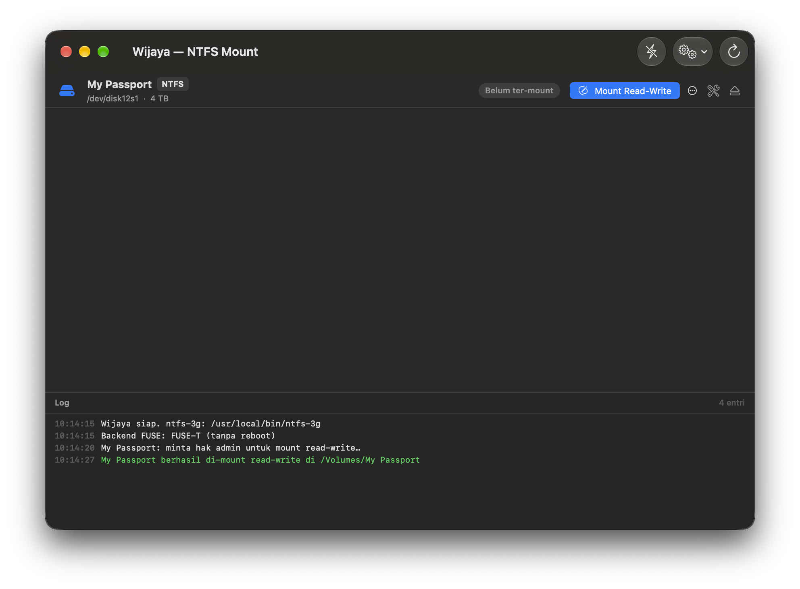
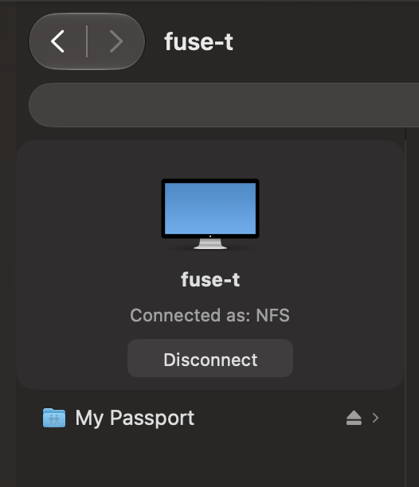
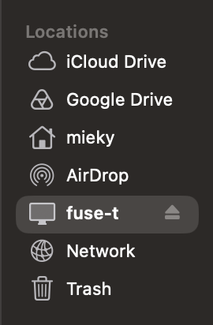

# Wijaya

🌐 [English](./README.md) · **Bahasa Indonesia**

**GUI baca-tulis NTFS untuk macOS.** Gratis, open source (MIT), tanpa langganan.

[](./LICENSE)


-1e293b.svg)

Aplikasi macOS **native (SwiftUI)** untuk membuat **disk NTFS** bisa dibaca-tulis dari Finder —
apa pun media-nya: **HDD, SSD, NVMe, flashdisk, atau SD card**. Deteksi volume,
**Mount Read-Write**, Mount Read-Only, Unmount, Eject, Repair, dan auto-mount — dibungkus di atas
driver `ntfs-3g` (open source) + FUSE-T.

Wijaya fokus pada **NTFS** (satu-satunya format yang macOS tidak bisa tulis sendiri). Format lain
tetap dikenali dan ditampilkan beserta statusnya — lihat [Format yang didukung](#format-yang-didukung).

🌐 **Situs + panduan lengkap:** <https://thickkoezz.github.io/wijaya/>



---

## Gratis selamanya (dan kenapa kamu akan melihat beberapa klik ekstra)

Wijaya adalah **freeware & open source, lisensi MIT**. Tidak ada biaya, tidak ada langganan,
tidak ada "pro version", tidak ada telemetri.

Satu hal yang perlu kamu tahu — dan mohon dimaklumi:

> Aku **tidak ikut berlangganan Apple Developer Program ($99/tahun)**. Itu biaya yang diperlukan
> agar aplikasi bisa ditandatangani & dinotarisasi Apple (Developer ID). Karena tidak ada tanda
> tangan itu, saat memasang Wijaya macOS akan menampilkan peringatan *"unidentified developer"*
> dan kamu perlu **klik-kanan → Open** sekali (atau pakai Homebrew, yang bebas peringatan).

Sebagai gantinya, aku meminta pengertianmu untuk menempuh **beberapa klik tambahan** saat
instalasi. Itu harga kecil dibanding $99/tahun yang harus kubayar terus-menerus — dan itulah yang
membuat aplikasi ini **tetap gratis untuk semua orang**. Terima kasih. 🙏

Bahkan secara teknis, Wijaya sengaja menempuh jalur **FUSE-T (kext-less)** justru supaya kamu
**tidak perlu membayar apa pun** dan tidak perlu menurunkan keamanan sistem (Reduced Security).

---

## Status

Sudah dipakai sehari-hari dan **berfungsi baca-tulis**. Distribusi tersedia lewat
**.pkg / .dmg**, **Homebrew Cask**, atau **build dari sumber**. Paket belum ditandatangani
Apple — lihat [Gratis selamanya](#gratis-selamanya-dan-kenapa-kamu-akan-melihat-beberapa-klik-ekstra).

---

## Tangkapan layar

| Jendela utama | FUSE-T aktif | Volume di Finder |
|---|---|---|
|  |  |  |

---

## Instalasi cepat (TL;DR)

```bash
# 1. Prasyarat
brew install --cask macos-fuse-t/homebrew-cask/fuse-t

# 2. Unduh Wijaya (.pkg/.dmg dari Releases), lalu klik-kanan → Open (belum ditandatangani)

# 3. Beri Full Disk Access (System Settings → Privacy & Security → Full Disk Access):
#    /usr/local/bin/ntfs-3g   ·   /bin/bash   ·   Wijaya.app
```

Panduan lengkap — termasuk **build dari sumber** dan **cara memberi izin tiap komponen** —
ada di [Instalasi langkah demi langkah](#instalasi-langkah-demi-langkah).

---

## Cara kerja

```
┌───────────────────────────────┐
│ Wijaya.app (SwiftUI, user)     │  daftar volume + tombol aksi + log
│  DiskScanner / FuseDiagnostics │
└───────────────┬────────────────┘
                │ satu prompt password (osascript admin)
┌───────────────┴────────────────┐
│ skrip root: diskutil unmountDisk force
│   → ntfs-3g ... /dev/diskXsY /Volumes/<label>
│   → verifikasi tulis (WIJAYA_OK) │
└───────────────┬────────────────┘
                │
┌───────────────┴────────────────┐
│ ntfs-3g (/usr/local/bin)        │  tertaut langsung ke libfuse-t
└───────────────┬────────────────┘
                │
┌───────────────┴────────────────┐
│ FUSE-T (libfuse-t.dylib)        │  kext-less, mount via NFS lokal
└─────────────────────────────────┘
```

Tiga hal penting yang membuatnya bekerja di macOS 26:
- **FUSE-T, bukan macFUSE.** macFUSE butuh system/kext extension yang di Tahoe sering tak
  bisa di-approve → ntfs-3g mati beberapa detik setelah mount.
- **ntfs-3g khusus yang tertaut `libfuse-t`.** Homebrew `ntfs-3g-mac` tertaut ke macFUSE,
  jadi tidak terpakai di sini. Kita build dari fork `macos-fuse-t/ntfs-3g`.
- **Full Disk Access.** Sejak macOS Sequoia+, TCC memblokir akses `/dev/diskX` **bahkan
  sebagai root** → tanpa izin ini, mount gagal `Operation not permitted`.

---

## Prasyarat (daftar lengkap)

| # | Komponen | Versi/uji | Untuk apa | Cara pasang |
|---|----------|-----------|-----------|-------------|
| 1 | **macOS** | 26.x (Tahoe), Apple Silicon | sistem | — |
| 2 | **Xcode Command Line Tools** | terbaru | compiler untuk build driver & app | `xcode-select --install` |
| 3 | **Homebrew** | terbaru | memasang dependensi | [brew.sh](https://brew.sh) |
| 4 | **FUSE-T** | 1.2.9+ | lapisan FUSE kext-less (libfuse-t) | `brew install --cask macos-fuse-t/homebrew-cask/fuse-t` |
| 5 | **ntfs-3g (build FUSE-T)** | fork `macos-fuse-t` | driver NTFS baca-tulis | `bash scripts/install-driver.sh` (lihat di bawah) |
| 6 | **ntfsfix** | opsional | perbaikan NTFS "dirty" | `brew install gromgit/fuse/ntfs-3g-mac` |
| 7 | **XcodeGen** | opsional | generate proyek Xcode | `brew install xcodegen` |

Dependensi **build** (dibutuhkan langkah 5): `autoconf automake libtool pkgconf gettext`.

---

## Instalasi langkah demi langkah

### 1. Command Line Tools + Homebrew
```bash
xcode-select --install
/bin/bash -c "$(curl -fsSL https://raw.githubusercontent.com/Homebrew/install/HEAD/install.sh)"
```

### 2. Dependensi + FUSE-T
```bash
brew install autoconf automake libtool pkgconf gettext
brew install --cask macos-fuse-t/homebrew-cask/fuse-t
# (opsional, untuk tombol Repair) :
brew install gromgit/fuse/ntfs-3g-mac
```
Cek FUSE-T: pastikan `/usr/local/lib/libfuse-t.dylib` ada.

### 3. Build & install driver ntfs-3g (FUSE-T)
```bash
git clone <repo-wijaya> && cd wijaya
bash scripts/install-driver.sh        # minta password admin sekali
```
Script ini meng-clone `macos-fuse-t/ntfs-3g`, build, lalu memasang ke
`/usr/local/bin/ntfs-3g` (+ `libntfs-3g.*.dylib` ke `/usr/local/lib`).
Verifikasi: `otool -L /usr/local/bin/ntfs-3g | grep libfuse-t`.

> **Perhatian:** Homebrew juga memasang `ntfs-3g` (dari `ntfs-3g-mac`) di `/opt/homebrew/bin`
> yang tertaut macFUSE. Wijaya **mengutamakan `/usr/local/bin/ntfs-3g`** (build FUSE-T).

### 4. Build & jalankan aplikasi
```bash
./scripts/dev.sh          # xcodegen + xcodebuild + open .app
```
Atau manual:
```bash
xcodegen generate
xcodebuild -project Wijaya.xcodeproj -scheme Wijaya -configuration Debug -derivedDataPath build build
open build/Build/Products/Debug/Wijaya.app
```

### 5. ⚠️ Izin Full Disk Access (WAJIB, sekali saja)

macOS memblokir akses `/dev/disk` lewat TCC **bahkan untuk root**. Beri izin ke binary yang
menyentuh device dan ke aplikasinya:

**System Settings → Privacy & Security → Full Disk Access → `+`**
(Di dialog pemilih file tekan **⌘⇧G** lalu ketik path-nya.)

| Yang ditambahkan | Path | Kenapa |
|---|---|---|
| driver NTFS | `/usr/local/bin/ntfs-3g` | membuka `/dev/diskXsY` (wajib) |
| shell root | `/bin/bash` | interpreter skrip mount (wajib) |
| aplikasi | **Wijaya.app** | pemanggil proses root |

Aktifkan toggle-nya. **FDA terikat ke hash binary** — kalau `ntfs-3g` di-build ulang/di-upgrade,
tambahkan ulang. (Ini juga sebabnya Homebrew `ntfs-3g-mac` perlu izin terpisah.)

### 6. Verifikasi
```bash
build/Build/Products/Debug/Wijaya.app/Contents/MacOS/Wijaya --scan
```
Contoh output sehat:
```
ntfs-3g : /usr/local/bin/ntfs-3g  fuseT=true
FUSE-T  : /usr/local/lib/libfuse-t.dylib
backends: macFUSE, FUSE-T (tanpa reboot)
```

---

## Membuat paket installer (.pkg / .dmg)

Untuk distribusi (pengguna lain tak perlu build sendiri):

```bash
bash scripts/build-pkg.sh
# → build/pkg/Wijaya-<versi>.pkg  dan  build/pkg/Wijaya-<versi>.dmg
```

Isi paket:

| Path | Isi |
|---|---|
| `/Applications/Wijaya.app` | aplikasi (build Release) |
| `/usr/local/bin/ntfs-3g` | driver ntfs-3g (build FUSE-T) |
| `/usr/local/lib/libntfs-3g.*.dylib` | runtime ntfs-3g |

Skrip `postinstall` memperbaiki permission driver dan **membuka panel Full Disk Access**
agar pengguna mudah memberi izin. Prasyarat bagi pengguna: **FUSE-T** sudah terpasang.

Memasang:
```bash
open build/pkg/Wijaya-<versi>.pkg          # klik Install
# atau:
sudo installer -pkg build/pkg/Wijaya-<versi>.pkg -target / -allowUntrusted
```

> **Paket belum ditandatangani/notarized** — dan tidak perlu. Developer ID + notarization Apple
> **berbayar ($99/tahun)**. Lihat [Distribusi gratis](#distribusi-gratis-tanpa-developer-id).
> **Catatan:** memasang versi driver baru mengubah hash binary → izin Full Disk Access untuk
> `/usr/local/bin/ntfs-3g` mungkin perlu ditambahkan ulang.

---

## Distribusi gratis (tanpa Developer ID)

Tanda tangan & notarization Apple memerlukan **Apple Developer Program (bayar $99/tahun)**.
Tidak wajib — ada tiga jalur gratis:

**1. Homebrew Cask (paling nyaman bagi pengguna).**
Host `Wijaya-<versi>.dmg` di GitHub Releases, sediakan tap dengan `Casks/wijaya.rb`
(template tersedia di repo ini). Pengguna cukup:
```bash
brew tap USER/wijaya
brew install --cask wijaya
```
Instal lewat brew **tidak** memberi atribut `quarantine`, sehingga tidak muncul peringatan
Gatekeeper walau tanpa tanda tangan Apple.

**2. Installer unsigned.**
Bagikan `.pkg`/`.dmg`; pengguna membuka dengan klik-kanan → **Open**, atau:
```bash
xattr -dr com.apple.quarantine ~/Downloads/Wijaya-<versi>.dmg
sudo installer -pkg Wijaya-<versi>.pkg -target / -allowUntrusted
```

**3. Build dari sumber.**
Paling aman dari sisi Gatekeeper (app yang dibangun lokal tidak di-quarantine).

Untuk merilis:
```bash
bash scripts/release.sh    # bangun paket + cetak sha256 & potongan cask
```

---

## Cara pakai

1. Colok disk NTFS → muncul sebagai chip **"Read-Only (macOS)"**.
2. Klik **Mount Read-Write** → masukkan password admin → chip jadi **"Read-Write"**.
3. Tombol **⋯** memberi opsi: **Hapus hiberfil & mount** (NTFS hibernated) dan **Mount Read-Only**.
4. **Sebelum mencabut: klik Eject atau Unmount** (FUSE-T punya write cache — cabut tanpa
   eject berisiko korupsi NTFS).

### Auto-mount (latar belakang, tanpa prompt)

Klik tombol **`Auto-mount: OFF`** di toolbar → berubah jadi **`Auto-mount: ON`** (minta password
admin sekali). Ini memasang:

| Komponen | Path | Peran |
|---|---|---|
| skrip mount | `/usr/local/libexec/wijaya-automount.sh` | mount NTFS RW via ntfs-3g |
| aturan sudo | `/etc/sudoers.d/wijaya-automount` | `NOPASSWD` **hanya** untuk skrip itu |
| LaunchAgent | `~/Library/LaunchAgents/com.mieky.wijaya.automount.plist` | `WatchPaths=/Volumes` |

Efeknya: begitu disk NTFS dicolok, otomatis di-mount **read-write** tanpa klik & tanpa password,
dan tetap bekerja walau aplikasi ditutup. Mematikannya: klik tombol yang sama (ke `OFF`) —
semua komponen di atas dibersihkan.

> **Keamanan:** aturan sudo hanya mengizinkan satu skrip spesifik itu berjalan sebagai root —
> bukan akses `sudo` bebas. Skripnya milik root (`root:wheel`, mode 0755) dan bisa kamu tinjau
> di `Sources/Resources/wijaya-automount.sh`.

Cek aktivitas: `log show --last 5m --predicate 'eventMessage CONTAINS "wijaya-automount"'`.

---

## Troubleshooting

- **`Operation not permitted` saat mount** — belum ada Full Disk Access untuk
  `/usr/local/bin/ntfs-3g` dan `/bin/bash`. Ulangi Langkah 5. (Aplikasi akan menampilkan
  banner merah + tombol buka Settings saat mendeteksi ini.)
- **`unsafe state` / "hibernated"** — drive belum di-shutdown bersih dari Windows (Fast
  Startup). Ideal: boot Windows → matikan Fast Startup → **Shutdown penuh**. Cepat: tombol
  **Hapus hiberfil & mount** (⚠️ membuang sesi Windows yang ter-hibernate).
- **Mount sukses lalu hilang beberapa detik** — biasanya karena ntfs-3g tertaut macFUSE dan
  extension-nya diblokir. Pastikan `otool -L /usr/local/bin/ntfs-3g | grep libfuse-t` cocok
  (pakai build FUSE-T, bukan Homebrew `ntfs-3g-mac`).
- **Popup "…does not support permanent version storage"** (mis. save di TextEdit) — **normal &
  tidak berbahaya**; file tetap tersimpan. FUSE-T memount volume sebagai **network (NFS)**,
  dan macOS mematikan fitur **Versions** di volume non-native. Pakai editor non-NSDocument
  (CotEditor, VS Code, Sublime) kalau mengganggu.
- **Gagal unmount** — tutup file/aplikasi yang memakai volume, lalu coba lagi.
- **Status salah / "Belum ter-mount" padahal ada** — FUSE-T mount via NFS tidak dikenali
  `diskutil`; Wijaya mendeteksinya lewat tabel `mount`. Tekan Refresh.

---

## Format yang didukung

Wijaya menangani **NTFS** — satu-satunya format yang macOS tidak bisa tulis sendiri. Format lain
tetap muncul di daftar dengan status jujur, dan **tidak butuh Wijaya** karena macOS sudah
bisa membacanya sendiri.

| Format | Baca-tulis | Lewat Wijaya? |
|---|---|---|
| **NTFS** | ✅ lewat `ntfs-3g` | **ya** — inilah gunanya Wijaya (macOS cuma bisa baca) |
| exFAT | ✅ bawaan macOS | tidak perlu — Wijaya hanya menampilkan statusnya |
| FAT32 | ✅ bawaan macOS | tidak perlu |
| APFS / HFS+ | ✅ bawaan macOS | tidak perlu |
| ext4 / Btrfs (Linux) | ❌ tidak didukung | di luar cakupan |

**Soal media:** HDD, SSD, NVMe, flashdisk, sampai SD card semuanya sama saja — yang menentukan
hanyalah **filesystem**, bukan jenis disknya. Jadi **SSD berformat NTFS pun bisa langsung
dibaca-tulis** oleh Wijaya, sama seperti HDD.

---

## Backend

| Backend | Syarat | Status |
|---|---|---|
| **FUSE-T** (default) | `libfuse-t.dylib`, ntfs-3g build FUSE-T | disarankan, kext-less, tanpa reboot |
| **macFUSE** | system/kext extension di-approve | sering tak bisa di-approve di macOS 26 |

Backend dipilih otomatis (FUSE-T bila macFUSE belum siap); bisa diganti dari menu toolbar.

---

## Keterbatasan

- FUSE-T mount tampil sebagai volume **NFS** → tanpa Versions (lihat troubleshooting).
- Fitur "buka file yang sedang dipakai Windows" dsb. tidak ada; jangan menulis NTFS yang
  sedang dipakai OS lain.
- Paket installer (.pkg/.dmg) **belum ditandatangani/notarized**.

## Roadmap

1. Distribusi: Homebrew Cask + GitHub Releases (jalur **gratis**, tanpa Developer ID).
2. Auto-mount saat volume NTFS terdeteksi — ✅ sudah ada (tombol di toolbar).
3. Pemeriksaan FDA otomatis di dalam app (banner sudah ada).
4. Dukungan BitLocker (unlock) — di luar cakupan saat ini.
5. *(Opsional, hanya jika punya Developer ID)* signing + notarization.

---

## Arsitektur

```
Sources/
  WijayaApp.swift              # @main + entry CLI --scan
  Models/Volume.swift          # Volume + FileSystemKind + MountState
  Services/
    DiskScanner.swift          # diskutil list/info -plist + tabel mount → [Volume]
    FuseDiagnostics.swift      # deteksi ntfs-3g, macFUSE, FUSE-T, linkage libfuse-t
    ScriptBuilder.swift        # susun skrip root (shell-quote aman) + mode ro/rw
    PrivilegedRunner.swift     # osascript 'with administrator privileges'
    MountService.swift         # mount rw/ro/hapus-hiberfil / unmount / eject / repair
    DiagnosticsCLI.swift       # mode headless --scan
  ViewModels/VolumeListViewModel.swift
  Views/                       # ContentView, VolumeRow, SetupBanner, GuidanceBanner, LogPane
Tests/WijayaTests/             # 22 unit test (quoting, parser, diagnosis)
```

## Referensi

Pendekatan & temuan penting bersumber dari pengalaman nyata proyek serupa:
`PennybagsCX/ntfs-autorw` (konteks root vs sesi user, claim FSKit) dan
`pixian5/ntfsformac` (Full Disk Access wajib, build ntfs-3g dari `macos-fuse-t`).

## Lisensi

Wijaya adalah **freeware & open source**, dirilis di bawah **lisensi MIT** — lihat
[`LICENSE`](./LICENSE). Bebas dipakai, dimodifikasi, dan didistribusikan, termasuk untuk
keperluan komersial, asalkan menyertakan pemberitahuan lisensi.

Ketergantungan eksternal memiliki lisensinya masing-masing: `ntfs-3g` (GPL-2.0/LGPL-2.0),
`FUSE-T`, `macFUSE`. Paket installer menyertakan binary `ntfs-3g` yang dibangun terpisah;
sumbernya tersedia di <https://github.com/macos-fuse-t/ntfs-3g>.
