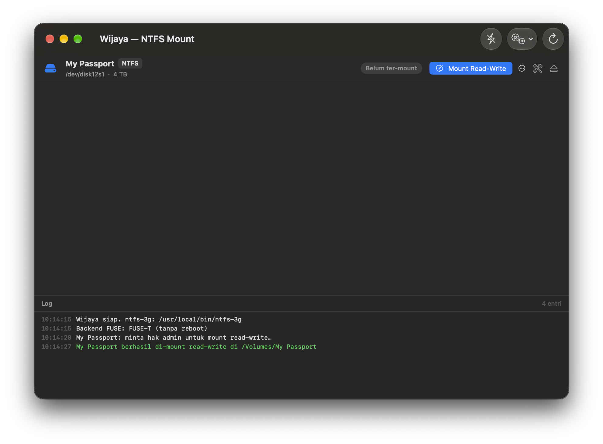
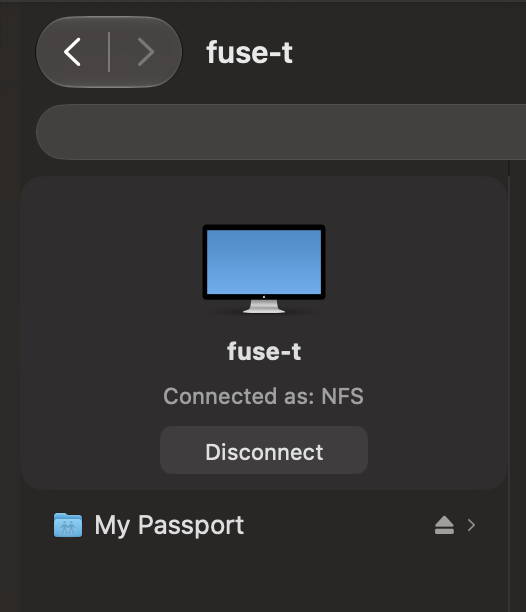
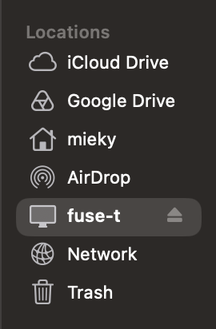

# Wijaya

**Read/write NTFS GUI for macOS.** Free, open source (MIT), no subscription.

[](./LICENSE)


-1e293b.svg)

🌐 **English** · [Bahasa Indonesia](./README.id.md)

A **native macOS app (SwiftUI)** that makes **NTFS disks** readable and writable from Finder —
whatever the media: **HDD, SSD, NVMe, flash drive or SD card**. Volume detection,
**Mount Read-Write**, Mount Read-Only, Unmount, Eject, Repair and auto-mount — wrapped around the
open-source `ntfs-3g` driver plus FUSE-T.

Wijaya focuses on **NTFS** — the one format macOS can't write natively. Other filesystems are still
detected and shown with their status — see [Supported formats](#supported-formats).

🌐 **Website + full guide:** <https://thickkoezz.github.io/wijaya/>



---

## Free forever (and why you'll see a few extra clicks)

Wijaya is **freeware and open source, MIT-licensed**. No fees, no subscription, no "pro version",
no telemetry.

One thing you should know — and please bear with me:

> I **don't subscribe to the Apple Developer Program ($99/year)**, the fee required to have the app
> signed and notarized by Apple (Developer ID). Without that signature, macOS shows an
> *"unidentified developer"* warning when you install Wijaya, and you have to **right-click → Open**
> once (or use Homebrew, which skips the warning).

In exchange, I'm asking for your understanding to spend **a few extra clicks** during installation.
It's a small price compared to the $99/year I would otherwise have to pay — and it's what keeps this
app **free for everyone**. Thank you.

Even technically, Wijaya deliberately takes the **FUSE-T (kext-less)** route precisely so that you
**don't have to pay anything** and don't have to weaken your system's security (Reduced Security).

---

## Status

Used daily and **read-write works**. Distributed via **.pkg / .dmg**, **Homebrew Cask**, or
**building from source**. The package is not yet signed by Apple — see
[Free forever](#free-forever-and-why-youll-see-a-few-extra-clicks).

---

## Screenshots

| Main window | FUSE-T active | Volume in Finder |
|---|---|---|
|  |  |  |

---

## Quick install (TL;DR)

```bash
# 1. Prerequisite
brew install --cask macos-fuse-t/homebrew-cask/fuse-t

# 2. Download Wijaya (.pkg/.dmg from Releases), then right-click → Open (unsigned)

# 3. Grant Full Disk Access (System Settings → Privacy & Security → Full Disk Access):
#    /usr/local/bin/ntfs-3g   ·   /bin/bash   ·   Wijaya.app
```

The full guide — including **building from source** and **how to grant permission to each
component** — is in [Step-by-step installation](#step-by-step-installation).

---

## How it works

```
┌───────────────────────────────┐
│ Wijaya.app (SwiftUI, user)     │  volume list + action buttons + log
│  DiskScanner / FuseDiagnostics │
└───────────────┬────────────────┘
                │ one password prompt (osascript admin)
┌───────────────┴────────────────┐
│ root script: diskutil unmountDisk force
│   → ntfs-3g ... /dev/diskXsY /Volumes/<label>
│   → write check (WIJAYA_OK)     │
└───────────────┬────────────────┘
                │
┌───────────────┴────────────────┐
│ ntfs-3g (/usr/local/bin)        │  linked directly to libfuse-t
└───────────────┬────────────────┘
                │
┌───────────────┴────────────────┐
│ FUSE-T (libfuse-t.dylib)        │  kext-less, mounted over local NFS
└─────────────────────────────────┘
```

Three things make it work on macOS 26:
- **FUSE-T, not macFUSE.** macFUSE needs a system/kext extension that often can't be approved on
  Tahoe → ntfs-3g dies a few seconds after mounting.
- **A purpose-built ntfs-3g linked against `libfuse-t`.** Homebrew's `ntfs-3g-mac` links against
  macFUSE, so it isn't used here. We build from the `macos-fuse-t/ntfs-3g` fork.
- **Full Disk Access.** Since macOS Sequoia+, TCC blocks access to `/dev/diskX` **even as root** →
  without this permission, mounting fails with `Operation not permitted`.

---

## Prerequisites (full list)

| # | Component | Version/tested | Purpose | How to install |
|---|-----------|----------------|---------|----------------|
| 1 | **macOS** | 26.x (Tahoe), Apple Silicon | the OS | — |
| 2 | **Xcode Command Line Tools** | latest | compiler for building the driver & app | `xcode-select --install` |
| 3 | **Homebrew** | latest | installing dependencies | [brew.sh](https://brew.sh) |
| 4 | **FUSE-T** | 1.2.9+ | kext-less FUSE layer (libfuse-t) | `brew install --cask macos-fuse-t/homebrew-cask/fuse-t` |
| 5 | **ntfs-3g (FUSE-T build)** | `macos-fuse-t` fork | read/write NTFS driver | `bash scripts/install-driver.sh` (see below) |
| 6 | **ntfsfix** | optional | repairing a "dirty" NTFS | `brew install gromgit/fuse/ntfs-3g-mac` |
| 7 | **XcodeGen** | optional | generating the Xcode project | `brew install xcodegen` |

**Build** dependencies (needed for step 5): `autoconf automake libtool pkgconf gettext`.

---

## Step-by-step installation

### 1. Command Line Tools + Homebrew
```bash
xcode-select --install
/bin/bash -c "$(curl -fsSL https://raw.githubusercontent.com/Homebrew/install/HEAD/install.sh)"
```

### 2. Dependencies + FUSE-T
```bash
brew install autoconf automake libtool pkgconf gettext
brew install --cask macos-fuse-t/homebrew-cask/fuse-t
# (optional, for the Repair button):
brew install gromgit/fuse/ntfs-3g-mac
```
Check FUSE-T: make sure `/usr/local/lib/libfuse-t.dylib` exists.

### 3. Build & install the ntfs-3g driver (FUSE-T)
```bash
git clone https://github.com/thickkoezz/wijaya.git && cd wijaya
bash scripts/install-driver.sh        # asks for your admin password once
```
This script clones `macos-fuse-t/ntfs-3g`, builds it, then installs it to
`/usr/local/bin/ntfs-3g` (+ `libntfs-3g.*.dylib` into `/usr/local/lib`).
Verify: `otool -L /usr/local/bin/ntfs-3g | grep libfuse-t`.

> **Careful:** Homebrew also installs an `ntfs-3g` (from `ntfs-3g-mac`) into `/opt/homebrew/bin`
> that links against macFUSE. Wijaya **prefers `/usr/local/bin/ntfs-3g`** (the FUSE-T build).

### 4. Build & run the app
```bash
./scripts/dev.sh          # xcodegen + xcodebuild + open .app
```
Or manually:
```bash
xcodegen generate
xcodebuild -project Wijaya.xcodeproj -scheme Wijaya -configuration Debug -derivedDataPath build build
open build/Build/Products/Debug/Wijaya.app
```

### 5. ⚠️ Full Disk Access permission (REQUIRED, once)

macOS blocks access to `/dev/disk` through TCC **even for root**. Grant permission to the binary
that touches the device and to the app itself:

**System Settings → Privacy & Security → Full Disk Access → `+`**
(In the file picker press **⌘⇧G** and type the path.)

| Add | Path | Why |
|---|---|---|
| NTFS driver | `/usr/local/bin/ntfs-3g` | opens `/dev/diskXsY` (required) |
| root shell | `/bin/bash` | interpreter for the mount script (required) |
| the app | **Wijaya.app** | the caller of the root process |

Turn the toggles on. **FDA is bound to the binary's hash** — if `ntfs-3g` is rebuilt/upgraded,
add it again. (That's also why Homebrew's `ntfs-3g-mac` needs its own permission.)

### 6. Verify
```bash
build/Build/Products/Debug/Wijaya.app/Contents/MacOS/Wijaya --scan
```
Example of a healthy output:
```
ntfs-3g : /usr/local/bin/ntfs-3g  fuseT=true
FUSE-T  : /usr/local/lib/libfuse-t.dylib
backends: macFUSE, FUSE-T (no reboot needed)
```

---

## Building the installer (.pkg / .dmg)

For distribution (so other users don't have to build anything):

```bash
bash scripts/build-pkg.sh
# → build/pkg/Wijaya-<version>.pkg  and  build/pkg/Wijaya-<version>.dmg
```

Package contents:

| Path | Contents |
|---|---|
| `/Applications/Wijaya.app` | the app (Release build) |
| `/usr/local/bin/ntfs-3g` | ntfs-3g driver (FUSE-T build) |
| `/usr/local/lib/libntfs-3g.*.dylib` | ntfs-3g runtime |

The `postinstall` script fixes the driver's permissions and **opens the Full Disk Access pane** so
users can grant permission easily. User prerequisite: **FUSE-T** already installed.

Installing:
```bash
open build/pkg/Wijaya-<version>.pkg          # click Install
# or:
sudo installer -pkg build/pkg/Wijaya-<version>.pkg -target / -allowUntrusted
```

> **The package is unsigned/unnotarized** — and doesn't need to be. An Apple Developer ID +
> notarization is **paid ($99/year)**. See
> [Free distribution](#free-distribution-without-a-developer-id).
> **Note:** installing a new driver version changes the binary hash → the Full Disk Access
> permission for `/usr/local/bin/ntfs-3g` may need to be added again.

---

## Free distribution (without a Developer ID)

Apple signing & notarization require the **Apple Developer Program (paid, $99/year)**. It's not
mandatory — there are three free paths:

**1. Homebrew Cask (most convenient for users).**
Host `Wijaya-<version>.dmg` on GitHub Releases and provide a tap containing `Casks/wijaya.rb`
(a template is included in this repo). Users just run:
```bash
brew tap thickkoezz/wijaya
brew install --cask wijaya
```
Installing via brew does **not** add the `quarantine` attribute, so no Gatekeeper warning appears
even without an Apple signature.

**2. Unsigned installer.**
Share the `.pkg`/`.dmg`; users open it with right-click → **Open**, or:
```bash
xattr -dr com.apple.quarantine ~/Downloads/Wijaya-<version>.dmg
sudo installer -pkg Wijaya-<version>.pkg -target / -allowUntrusted
```

**3. Build from source.**
Safest from Gatekeeper's point of view (locally built apps aren't quarantined).

To publish:
```bash
bash scripts/release.sh    # builds the package + prints sha256 & a cask snippet
```

---

## Usage

1. Plug in an NTFS disk → it appears with the **"Read-Only (macOS)"** chip.
2. Click **Mount Read-Write** → enter your admin password → the chip becomes **"Read-Write"**.
3. The **⋯** button offers: **Remove hiberfile & mount** (hibernated NTFS) and **Mount Read-Only**.
4. **Before unplugging: click Eject or Unmount** (FUSE-T has a write cache — pulling the disk
   without ejecting risks corrupting the NTFS).

### Auto-mount (background, no prompt)

Click the **`Auto-mount: OFF`** button in the toolbar → it becomes **`Auto-mount: ON`** (asks for
your admin password once). This installs:

| Component | Path | Role |
|---|---|---|
| mount script | `/usr/local/libexec/wijaya-automount.sh` | mounts NTFS RW via ntfs-3g |
| sudo rule | `/etc/sudoers.d/wijaya-automount` | `NOPASSWD` for **that script only** |
| LaunchAgent | `~/Library/LaunchAgents/com.mieky.wijaya.automount.plist` | `WatchPaths=/Volumes` |

The effect: as soon as an NTFS disk is plugged in, it's automatically mounted **read-write** with no
clicks and no password, and it keeps working even if the app is closed. To turn it off: click the
same button (to `OFF`) — all the components above are removed.

> **Security:** the sudo rule only allows that one specific script to run as root — not free `sudo`
> access. The script is owned by root (`root:wheel`, mode 0755) and you can review it at
> `Sources/Resources/wijaya-automount.sh`.

Check activity: `log show --last 5m --predicate 'eventMessage CONTAINS "wijaya-automount"'`.

---

## Troubleshooting

- **`Operation not permitted` when mounting** — Full Disk Access hasn't been granted to
  `/usr/local/bin/ntfs-3g` and `/bin/bash`. Repeat Step 5. (The app shows a red banner + a button
  to open Settings when it detects this.)
- **`unsafe state` / "hibernated"** — the drive wasn't shut down cleanly from Windows (Fast
  Startup). Ideal fix: boot Windows → disable Fast Startup → **full Shutdown**. Quick fix: the
  **Remove hiberfile & mount** button (⚠️ discards the hibernated Windows session).
- **Mount succeeds then disappears after a few seconds** — usually because ntfs-3g links macFUSE
  and its extension is blocked. Make sure `otool -L /usr/local/bin/ntfs-3g | grep libfuse-t`
  matches (use the FUSE-T build, not Homebrew `ntfs-3g-mac`).
- **Popup "…does not support permanent version storage"** (e.g. saving in TextEdit) — **normal and
  harmless**; the file is still saved. FUSE-T mounts the volume as a **network (NFS)** volume, and
  macOS disables the **Versions** feature on non-native volumes. Use a non-NSDocument editor
  (CotEditor, VS Code, Sublime) if it bothers you.
- **Unmount fails** — close any file/app using the volume, then try again.
- **Wrong status / "Not mounted" even though it is** — FUSE-T mounts over NFS aren't recognized by
  `diskutil`; Wijaya detects them via the `mount` table. Press Refresh.

---

## Supported formats

Wijaya handles **NTFS** — the one format macOS can't write natively. Other filesystems still show
up in the list with an honest status, and **don't need Wijaya** because macOS already reads them.

| Format | Read/write | Via Wijaya? |
|---|---|---|
| **NTFS** | ✅ via `ntfs-3g` | **yes** — that's what Wijaya is for (macOS is read-only) |
| exFAT | ✅ built into macOS | not needed — Wijaya just shows its status |
| FAT32 | ✅ built into macOS | not needed |
| APFS / HFS+ | ✅ built into macOS | not needed |
| ext4 / Btrfs (Linux) | ❌ unsupported | out of scope |

**About media:** HDD, SSD, NVMe, flash drive, even SD cards are all the same — only the
**filesystem** matters, not the kind of disk. So **an NTFS-formatted SSD can be read-written**
by Wijaya just like an HDD.

---

## Backend

| Backend | Requirement | Status |
|---|---|---|
| **FUSE-T** (default) | `libfuse-t.dylib`, ntfs-3g built for FUSE-T | recommended, kext-less, no reboot |
| **macFUSE** | system/kext extension approved | often can't be approved on macOS 26 |

The backend is chosen automatically (FUSE-T when macFUSE isn't ready); you can switch it from the
toolbar menu.

---

## Limitations

- FUSE-T mounts appear as an **NFS** volume → no Versions (see troubleshooting).
- There's no "open a file that Windows is using" feature; don't write to an NTFS volume that
  another OS is using.
- The installer (.pkg/.dmg) is **not signed/notarized**.

## Roadmap

1. Distribution: Homebrew Cask + GitHub Releases (the **free** path, no Developer ID).
2. Auto-mount when an NTFS volume is detected — ✅ done (toolbar button).
3. Automatic FDA check inside the app (the banner already exists).
4. BitLocker (unlock) support — out of scope for now.
5. *(Optional, only if you have a Developer ID)* signing + notarization.

---

## Architecture

```
Sources/
  WijayaApp.swift              # @main + --scan CLI entry
  Models/Volume.swift          # Volume + FileSystemKind + MountState
  Services/
    DiskScanner.swift          # diskutil list/info -plist + mount table → [Volume]
    FuseDiagnostics.swift      # detect ntfs-3g, macFUSE, FUSE-T, libfuse-t linkage
    ScriptBuilder.swift        # build the root script (safe shell quoting) + ro/rw modes
    PrivilegedRunner.swift     # osascript 'with administrator privileges'
    MountService.swift         # mount rw/ro/remove-hiberfile / unmount / eject / repair
    DiagnosticsCLI.swift       # headless --scan mode
  ViewModels/VolumeListViewModel.swift
  Views/                       # ContentView, VolumeRow, SetupBanner, GuidanceBanner, LogPane
Tests/WijayaTests/             # 22 unit tests (quoting, parser, diagnosis)
```

## References

The approach and key findings come from the real-world experience of similar projects:
`PennybagsCX/ntfs-autorw` (root vs user-session context, FSKit claim) and
`pixian5/ntfsformac` (Full Disk Access required, building ntfs-3g from `macos-fuse-t`).

## License

Wijaya is **freeware and open source**, released under the **MIT license** — see
[`LICENSE`](./LICENSE). Free to use, modify and distribute, including for commercial purposes, as
long as the license notice is included.

External dependencies have their own licenses: `ntfs-3g` (GPL-2.0/LGPL-2.0), `FUSE-T`, `macFUSE`.
The installer ships a separately built `ntfs-3g` binary; its source is available at
<https://github.com/macos-fuse-t/ntfs-3g>.
